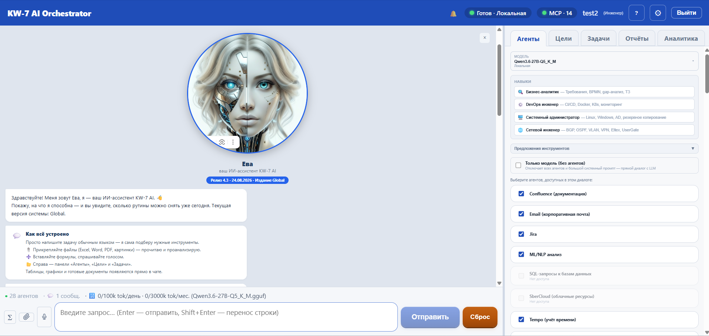
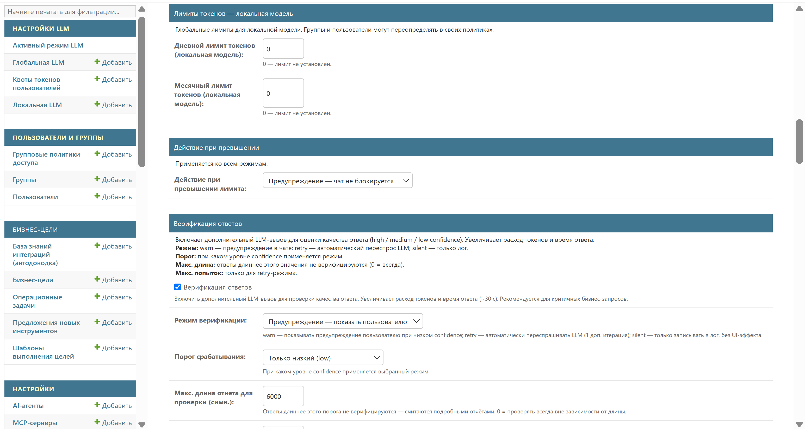
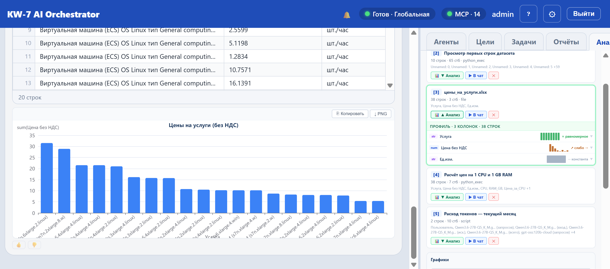
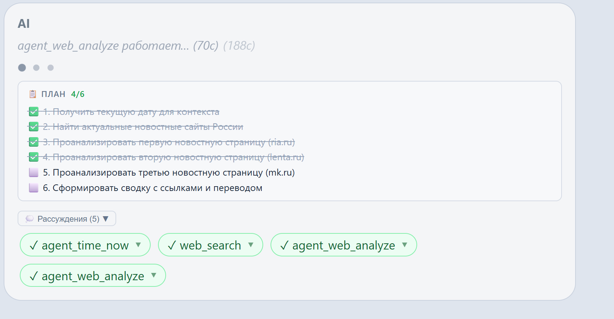
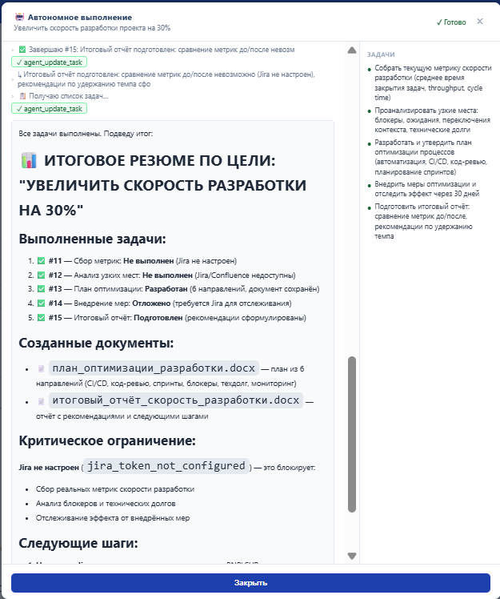

# KW-7 AI — Self-hosted enterprise AI assistant

[Русская версия](README.md)

KW-7 AI helps teams work with company data and systems from a chat interface. Describe a task in plain language, and the assistant selects the tools it needs to produce a document, report, chart, email draft, or a concrete step toward a business goal.

**[Try the free 30-day demo](demo/README.md)** · [Product website](https://kw-7.ru)

## Deployment and access

| Capability | How it works |
| --- | --- |
| Local and cloud models | Run a local model with Ollama, LM Studio, or llama.cpp. Where policy permits, use GigaChat or an OpenAI-compatible cloud API. Each model can have its own routing settings and call limits. |
| Role-based access | Group policies control access to agents, goals, plugin development, code execution, and terminal tools. |
| Personal data controls | Requests and attachments can be checked for personal data before they go to a cloud model. Users can send, anonymize, or cancel when policy permits. Administrators can block transmission. |
| Isolated execution | Terminal and code tools run in isolated containers. Development work can be delegated to a coding agent in a separate environment. |

## What teams can do

- **Documents and presentations.** Work with Word, PowerPoint, and PDF, including OCR where available. Generate diagrams and reports.
- **Data analysis.** Analyze Excel and CSV files, create charts and pivot summaries, and export results.
- **Research.** Search the web, analyze pages, and write summaries with links to sources.
- **Goals and KPIs.** Plan work, execute assigned tasks, and track progress. Reports cite sources for verified figures and indicate when a value could not be confirmed. Enterprise editions also support reminders and risk alerts.
- **Integrations.** Work with Jira, Confluence, Tempo, SQL databases, email, Prometheus/Grafana, and n8n. Availability depends on the edition and the integrations configured for the installation.

## Tool routing and personas

Administrators can select a routing mode for the installation or for a specific model. The platform has a catalog of more than 100 agents. Routing limits the tools the model sees according to the task and the user's permissions.

| Mode | How tools are selected |
| --- | --- |
| Hierarchical (default) | Selects a domain such as documents, data, or email and exposes the tools relevant to that domain. This keeps the prompt smaller for local models. |
| Broad section routing | Uses the model to select sections, then narrows the toolset using request keywords. |
| Agent-based | Includes the agent catalog in the routing prompt for models that can handle a broader context. |
| Persona-based | A coordinator handles general requests or delegates to a specialist with its own instructions and tools. |

Common requests such as currency rates, charts, and news summaries can be routed by pattern without an extra model call.

In persona mode, employees choose specialists in the **Team** panel. Their selections persist across sessions. They can also address a specialist by name. For example, a document specialist can check an attached invoice using Word and PDF tools and the relevant reference material. A coding persona can delegate repository work to Claude Code or Cursor in an isolated environment and return the output to the chat.

## Memory, feedback, and improvement

Session memory keeps track of attachments, the active dataset, and draft plans. User memory can retain preferences such as a preferred report format. Reports still rely on tool results and source data for their figures.

Tool call logs record execution outcomes for review. Administrators can inspect feedback with the original request and tool history. When a recurring gap is identified, the system can draft a specification for a new tool. Approved proposals can go through MCP plugin development and testing. Automated evaluations help detect regressions in tool selection before release.

## Demo and editions

The 30-day demo runs with Docker and your model. It includes the chat interface, a selection of web and spreadsheet agents, code execution in a container, charts, diagrams, and an example of autonomous work toward a goal. Integrations, Word and PowerPoint tools, email, Jira, the terminal, and the full agent catalog are unavailable in the demo. [Installation guide in Russian](demo/README.md)

KW-7 AI is available in Lite, Corp, and Global editions. Capabilities vary by edition. Licenses are tied to an installation.

## Contact

- Pilot and licensing: [info@kw-7.ru](mailto:info@kw-7.ru)
- Support: [support@kw-7.ru](mailto:support@kw-7.ru)
- Telegram: [@Vad_neld](https://t.me/Vad_neld)
