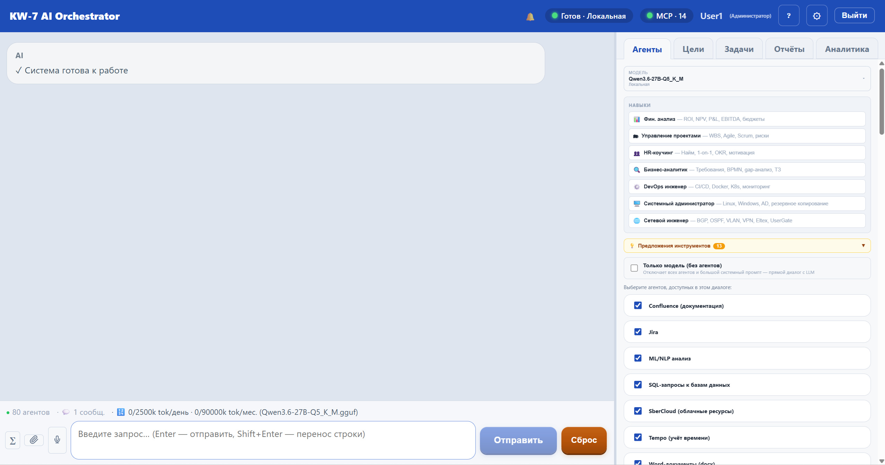

# KW-7 AI — корпоративный AI-ассистент

**AI-ассистент с агентами, который работает внутри вашей компании — на вашей модели и с
вашими данными.** Сотрудники ставят задачу обычным языком, а агенты сами находят данные,
считают, строят графики и схемы, готовят документы и презентации.

> **Попробовать бесплатно 30 дней:** [демо-версия — установка за 15 минут](demo/README.md)

---

## Почему KW-7 AI

**Работает в закрытом контуре.** Можно развернуть без выхода в интернет, на локальной
модели — данные не покидают компанию. Или подключить облачную модель (GigaChat и
OpenAI-совместимые) — переключение в один клик.

**Агенты, а не просто чат.** Ассистент сам выбирает нужные инструменты и выполняет
работу по шагам: открывает файлы и сайты, считает, строит графики, сохраняет результат.

**Цифрам можно доверять.** В отчётах у каждой цифры — ссылка на источник и цитата.
То, что подтвердить не удалось, система помечает сама.

**Автономные бизнес-цели.** Поставьте цель — система составит план, выполнит задачи,
соберёт данные и подготовит итоговый обзор. Человек остаётся в контуре: необратимые
действия требуют подтверждения.

**Защита персональных данных.** Перед отправкой в облачную модель система находит
персональные данные в сообщениях и файлах и предлагает их закрыть.

**Права по ролям.** Доступ к агентам и данным настраивается по группам сотрудников.

## Что умеет

| | |
|---|---|
| **Документы** | разбор и исправление Word, оформление по ГОСТ, сохранение отчётов |
| **Данные** | загрузка Excel и CSV, проверка качества, анализ, сводные таблицы, выгрузка |
| **Графики и схемы** | интерактивные графики (в том числе 3D), блок-схемы и схемы процессов |
| **Презентации** | создание и доработка PowerPoint со своим корпоративным стилем |
| **Интернет** | поиск, разбор сайтов и реестров, сводки новостей со ссылками на источники |
| **Расчёты** | формулы, вычисления, код в изолированной среде |
| **Почта и расписание** | письма, напоминания, отчёты по расписанию |
| **Записи встреч** | поиск момента в видеозаписи по расшифровке |
| **Интеграции** | Jira, Confluence, Tempo, базы данных PostgreSQL и MS SQL, Prometheus и Grafana, n8n |

## Для кого

- команды, которые хотят **автоматизировать отчёты и аналитику** без программирования;
- руководители, которым нужны **обзоры рынка и показателей** с проверяемыми источниками;
- компании, где **данные должны оставаться внутри** — KW-7 AI работает и без интернета,
  на локальной модели.

## Издания

Три издания — от базового с моделями и защитой данных до полного каталога агентов с
разработкой собственных инструментов. Состав и условия — по запросу.

## Демо-версия

Бесплатно на 30 дней: [установка, активация и подключение модели](demo/README.md).
Для запуска нужен Docker и ключ облачной модели или модель на своём компьютере.

## Контакты

- Покупка, лицензии, пилотные проекты: **info@kw-7.ru**
- Техническая поддержка: **support@kw-7.ru**
- Сайт: [kw-7.ru](https://kw-7.ru)
