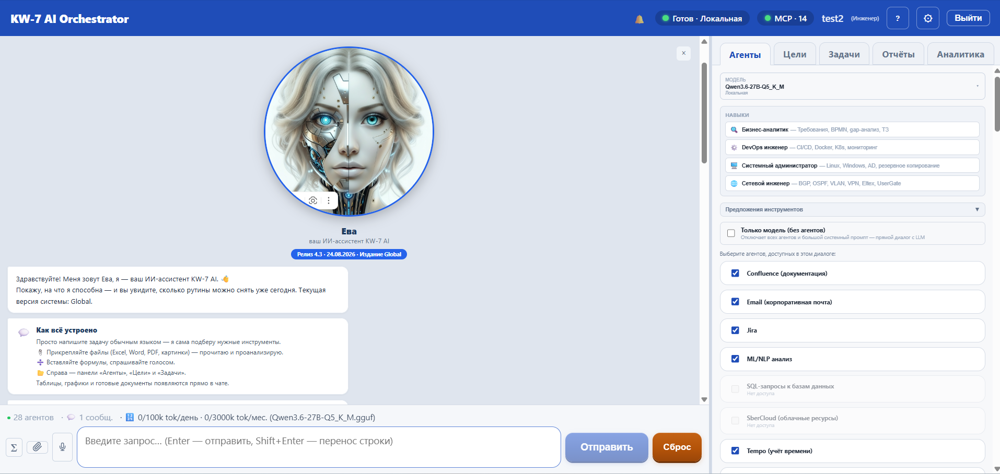
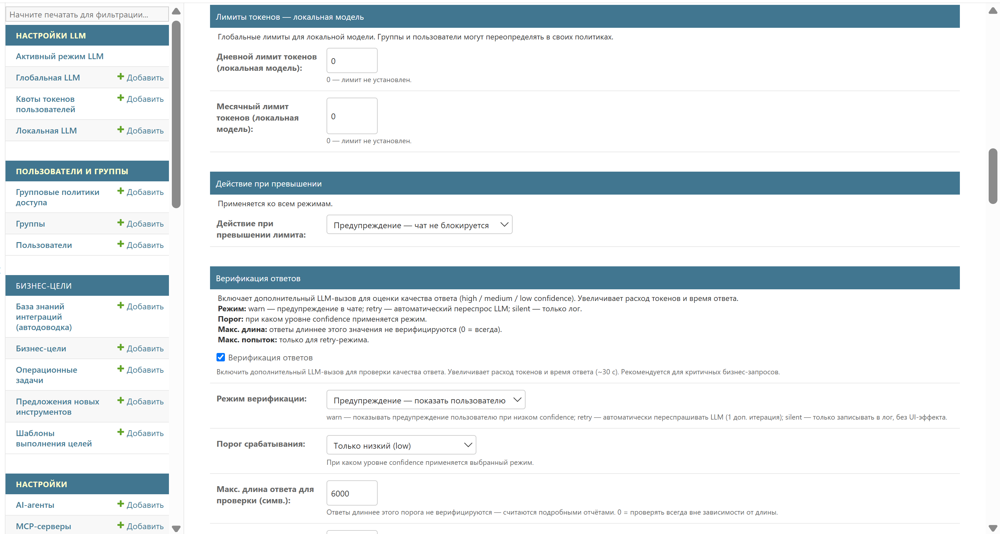
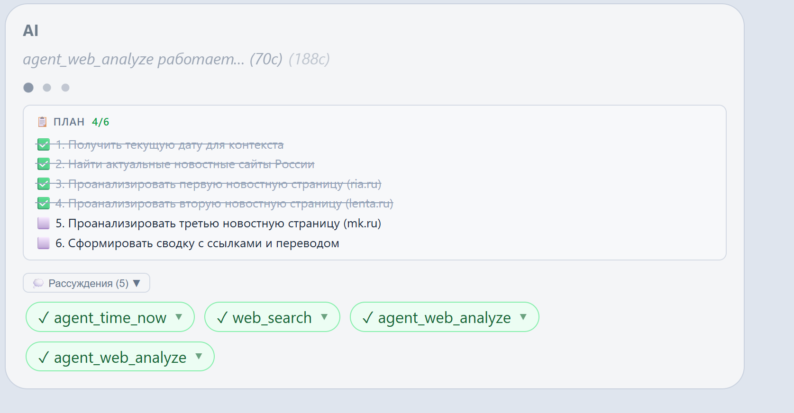
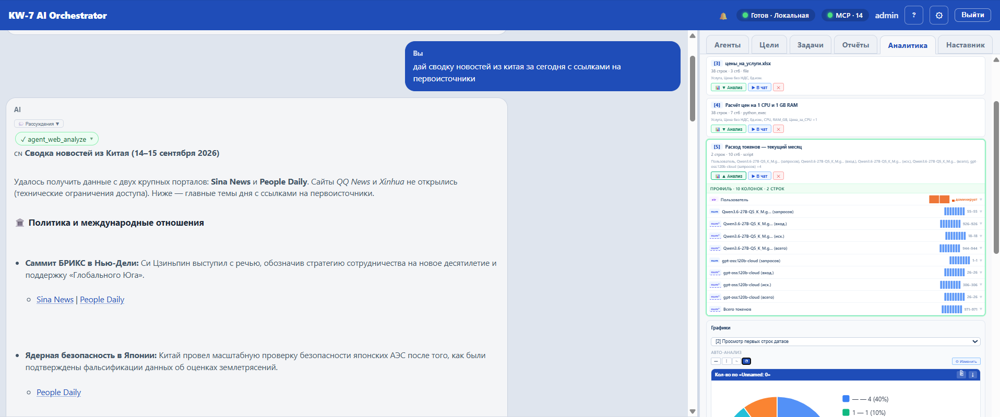
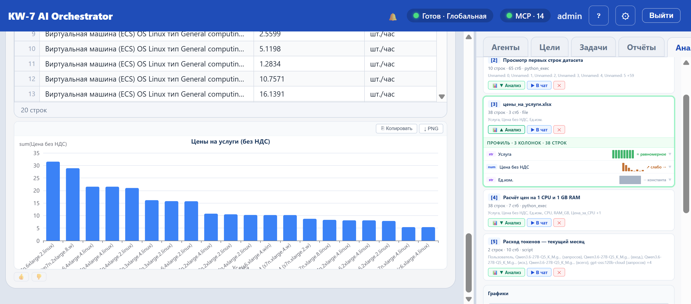
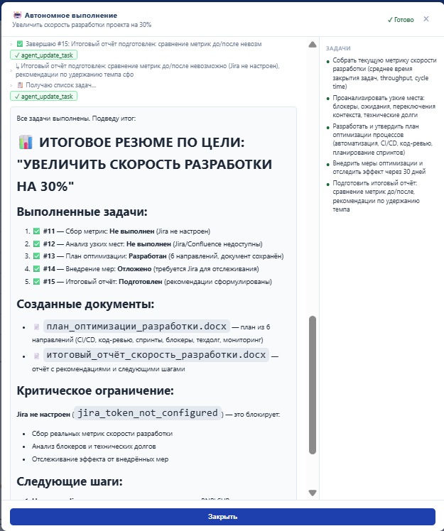

# KW-7 AI — корпоративный AI-ассистент

Платформа для работы с корпоративными данными и системами через чат с AI-агентами. Сотрудник формулирует задачу обычным языком; ассистент сам выбирает инструменты и доводит её до результата — документа, отчёта, графика, письма или шага по цели.

**[Попробовать бесплатно 30 дней](demo/README.md)**

---

## Почему KW-7 AI

| | |
|---|---|
| **Локальный и глобальный контур** | **Локальный** — модель у вас (Ollama, LM Studio, llama.cpp): данные и файлы в периметре, интернет не обязателен. **Глобальный** — облако (GigaChat, OpenAI-совместимые API): только для разрешённых пользователей. Режим переключается в интерфейсе; у каждой модели — свой профиль оркестратора (лимит вызовов, режим маршрутизации и др.). |
| **RBAC** | Группы, политики доступа: какие агенты, цели, разработка плагинов, код и терминал доступны каждой роли. |
| **Защита ПДн в глобальном контуре** | Перед отправкой в облако проверяются запрос и вложения; сотрудник решает: отправить, обезличить или отменить. Политика «не отправлять» закрывает данные автоматически. |
| **Цели и KPI** | Бизнес-цели, задачи, автономное выполнение, отчёты с проверкой цифр по источникам. Напоминания и проактивные алерты по рискам целей (корпоративные издания). Помощь привязана к корпоративным задачам, а не к личному чат-боту. |
| **100+ агентов** | Документы, данные, презентации, веб, почта, Jira, Confluence, Tempo, SQL, мониторинг, n8n, видео. **Терминал** и **код** — в изолированных контейнерах; агент разработки и делегирование внешнему кодеру — в отдельном контуре. |
| **Саморазвитие** | Gap-анализ и ТЗ на новый инструмент, генерация и доводка MCP-плагинов, база знаний API, автоматические замеры качества. Обратная связь пользователей — для разбора и доработки продукта. |

---

## Маршрутизация инструментов

Слабой модели нельзя показывать весь каталог сразу — падает точность выбора инструмента. Сильной модели узкий набор иногда не хватает. В админке задаётся **режим контекстного роутинга** (глобально или отдельно для каждой модели):

| Режим | Суть |
|---|---|
| **Иерархический** (по умолчанию) | Сначала выбирается **секция** (документы, данные, веб, почта…), модель видит только инструменты этой секции. Удобен для локальных моделей; меньше промпт, выше точность. |
| **По секциям (широкий)** | Секции выбирает LLM, затем сужение по ключевым словам запроса. |
| **По агентам** | В промпт роутинга попадает реестр агентов — максимальный контекст, для сильных облачных моделей. |
| **Через персон** | Координатор отвечает общими инструментами **или** передаёт запрос **специалисту** из панели «Команда» — у персоны свой промпт и свой узкий набор инструментов. |

Дополнительно **fast-pick**: по шаблонам запроса («курс валют», «график», «сводка новостей») секция выбирается без лишнего вызова LLM.

---

## Режим «Через персон»

В панели **«Команда»** сотрудник включает нужных специалистов (DevOps, финансы, документооборот, разработка…). Выбор **сохраняется между сессиями**. Можно обратиться по имени в тексте — тогда персона ведёт ход даже без автоделегирования.

**Пример.** Включена персона **«Наталья»** (документооборот). Запрос: *«Наталья, проверь вложение: соответствует ли счёт требованиям к первичным документам?»* — ход уходит ей, с инструментами разбора Word/PDF и справочником требований, а не общим набором «на все случаи».

Другой пример — **«Кодер»**: задача по репозиторию уходит внешнему агенту (Claude Code / Cursor) в изолированном окружении; в чат возвращается итог и артефакты.

---

## Память

| Уровень | Что хранится |
|---|---|
| **Сессия** | Загруженные файлы, активный датасет, черновик плана, служебные данные текущего диалога. |
| **Пользователь (долгосрочно)** | Ключ–значение между сессиями: предпочитаемый формат отчёта, типовые проекты, личные правила («всегда график в PNG»). Запись через инструмент памяти или автоматически из диалога; просмотр в админке. |
| **Предпочтения панели «Команда»** | Какие персоны включены у этого сотрудника. |
| **Ошибки инструментов** | После сбоев система подсказывает модели проверенный обход (без подмены фактов «из головы»). |

Память **не заменяет** корпоративные системы: для отчётов и цифр по-прежнему нужны реальные вызовы инструментов и источники.

---

## Обратная связь и развитие

- **Оценка ответа** (👍 / 👎 и комментарий) сохраняется вместе с текстом вопроса и списком использованных инструментов — для разбора качества, в том числе спустя время.
- **Журнал вызовов агентов** — аудит: кто, какой инструмент, с какими аргументами, ошибка или успех.
- **Предложения по инструментам** — если ассистент систематически не закрывает класс задач, формируется заявка с ТЗ; после одобрения — генерация MCP-плагина и подключение.
- **Корпус автотестов** — типовые сценарии прогоняются при сборке; регрессии по выбору инструментов видны до выката клиенту.

Обратная связь пользователей не подмешивается в ответ «на лету» без вашей политики — она идёт в triage администратора и в доработку промптов, роутинга и агентов (в том числе офлайн-замеры на ваших кейсах).

---

## Что умеет

| | |
|---|---|
| **Документы** | Word (ГОСТ), PDF/OCR, Excel/CSV, PowerPoint, схемы |
| **Данные** | Анализ таблиц, графики (в т.ч. 3D), сводные, выгрузка |
| **Интернет** | Поиск, разбор страниц, сводки со ссылками |
| **Цели** | План → выполнение → обзор; цифры с цитатой или пометка «не подтверждено» |
| **Системы** | Jira, Confluence, Tempo, БД, Prometheus/Grafana, почта, расписание |

---

## Для кого

- компании с **закрытым контуром** и локальной моделью;
- организации с **контролируемым доступом к облачным LLM** и ПДн;
- руководители и команды с **целями, KPI и проверяемыми отчётами**;
- ИТ — **RBAC, docker-compose, MCP**, лицензирование.

## Издания

Lite, Corp, Global — от моделей и ПДн до полного каталога и разработки плагинов. Лицензия с привязкой к установке. **info@kw-7.ru**

## Демо на 30 дней

Тот же чат, витрина агентов (веб, таблицы, код в контейнере, графики, схемы), пример **автономной цели** с проверкой цифр. Docker + ваша модель. **[Установка](demo/README.md)** (~15–20 мин).

Интеграции, Word/PowerPoint, почта, Jira, терминал и полный каталог в демо недоступны — система сообщит об этом явно.

## Контакты

- Покупка, лицензии, пилот: **info@kw-7.ru**
- Поддержка: **support@kw-7.ru**
- Telegram: [@Vad_neld](https://t.me/Vad_neld)
- Сайт: [kw-7.ru](https://kw-7.ru)
